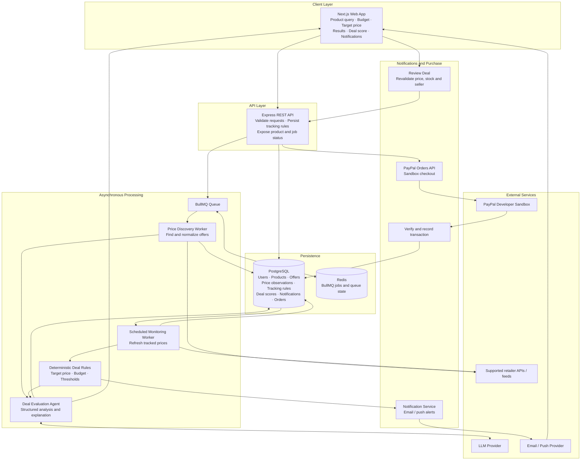
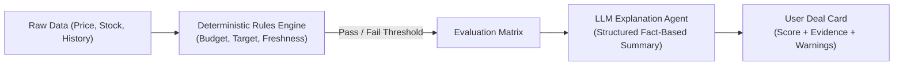
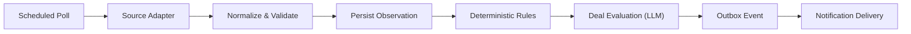
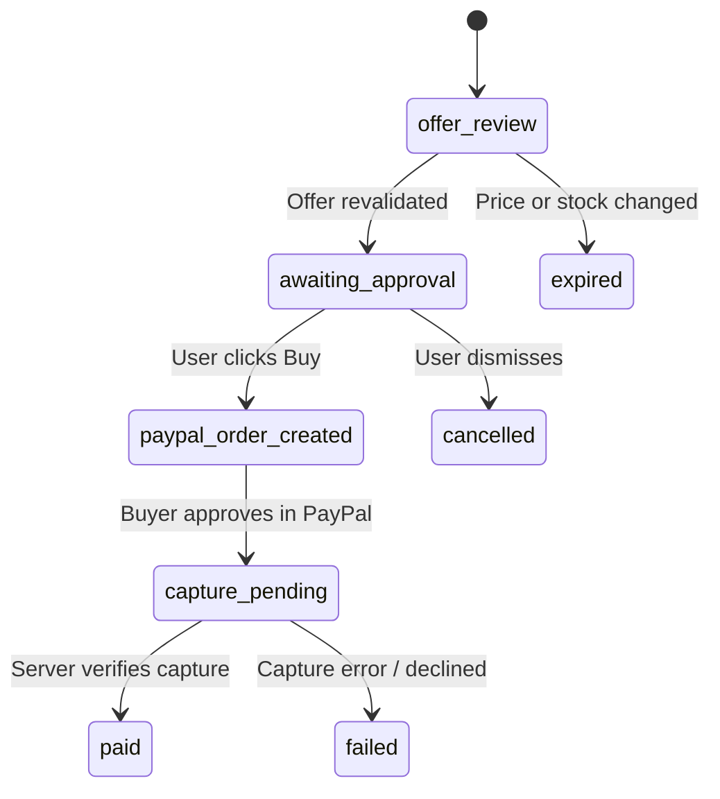

# 🎯 DealPilot

> **Your autonomous, AI-powered deal-hunting and price-monitoring agent.**

DealPilot monitors product deals across retailers in the background. When an item hits your target price or historical low, it alerts you instantly and enables seamless, verified checkout via PayPal integration with a single tap.

---

## 📑 Table of Contents

- [Overview & Value Proposition](#-overview--value-proposition)
- [How It Works (Example Flow)](#-how-it-works-example-flow)
- [System Architecture](#-system-architecture)
- [Core User Flows](#-core-user-flows)
  - [A. Product Discovery & Evaluation](#a-discover-a-product-and-evaluate-current-deals)
  - [B. Asynchronous Price Tracking](#b-track-a-price-asynchronously)
  - [C. Deal Review & Secure Checkout](#c-review-and-purchase)
- [Components & Responsibilities](#-components--responsibilities)
- [Data Model & Entities](#-data-model--entities)
- [Deal Scoring & AI Guardrails](#-deal-scoring--ai-guardrails)
- [API Reference](#-api-reference)
- [Reliability, Safety & Guardrails](#-reliability-safety--guardrails)
- [Deep-Dive Design Improvements](#-deep-dive-design-improvements)
  - [1. Decoupled Pipeline](#1-decoupled-collection-evaluation-and-notification-pipeline)
  - [2. Source Adapters & Contract](#2-source-adapters--normalized-offer-contract)
  - [3. Freshness & Evidence States](#3-first-class-data-freshness--evidence)
  - [4. Scoring Confidence & Explainability](#4-deal-scoring-confidence--explainability)
  - [5. Shopping Strategies](#5-flexible-shopping-strategies)
  - [6. Adaptive Polling Engine](#6-adaptive-polling-with-source-rate-limits)
  - [7. Transactional Outbox Pattern](#7-transactional-outbox-for-reliable-delivery)
  - [8. Checkout State Machine](#8-explicit-checkout-state-machine)
  - [9. Operational Data Model](#9-operational-data-model)
  - [10. Observability & Telemetry](#10-observability--telemetry)
  - [11. Security Safeguards](#11-security--access-control-safeguards)
  - [12. Failure-Path Test Suite](#12-failure-path-test-suite)
- [MVP Roadmap & Architecture Decision](#-mvp-roadmap--architecture-decision)

---

## 💡 Overview & Value Proposition

Shopping online requires manual checking, price comparison across dozens of tabs, and navigating fake discounts. **DealPilot** automates this entire lifecycle:

1. **Intelligent Discovery**: Parses natural language requests ("best noise-canceling headphones under ₹20,000") and aggregates normalized offers from supported retailer feeds.
2. **Deterministic & AI Deal Scoring**: Computes objective deal scores based on verifiable price history and vendor reliability, using AI solely to explain offer quality without hallucinating discounts.
3. **Autonomous Monitoring**: Runs background workers via Redis/BullMQ to poll prices on an adaptive schedule without violating vendor rate limits.
4. **Frictionless, Safe Checkout**: Sends push/email notifications with an offer revalidation step, orchestrating safe purchases through PayPal Sandbox checkout.

---

## 🚶 How It Works (Example Flow)

```
[User Query] ────────► [Agent Discovery] ────────► [Interactive Results]
"Headphones under 20K"   Crawls & normalizes         Shows deals + rating
                                                              │
                    ┌─────────────────────────────────────────┴──────────────────────────────┐
                    ▼                                                                        ▼
            [Instant Buy]                                                           [Track Price]
       PayPal Sandbox Checkout                                                  Worker polls every ~2 hrs
                                                                                             │
                                                                                             ▼
                                                                                    [Target Price Hit!]
                                                                                Push alert sent to phone/PC
                                                                                             │
                                                                                             ▼
                                                                                   [Review & 1-Click Pay]
                                                                                   Verified PayPal capture
```

1. **User Search**: The user enters: _"I want the best headphones under ₹20,000"_.
2. **Autonomous Crawl**: An agent queries supported sources, normalizes variants, and ranks offers within the specified budget.
3. **Deal Evaluation**: Every offer receives a transparent deal score based on verifiable historical observations and seller reputation.
4. **User Action**: The user can purchase immediately or tap **Track Price** with a custom target threshold.
5. **Background Monitoring**: An async BullMQ worker checks prices periodically (e.g., every 2 hours or on an adaptive schedule).
6. **Smart Alerting**: When the price drops to or below the target, a deduplicated notification is delivered to the user's laptop/phone.
7. **Revalidation & Purchase**: The user clicks **Review Deal**, the backend verifies live stock and price, and the order is completed safely via PayPal.

---

## ADDONS

Use these in the produ t too

1. Channel3
   Where: Product discovery and offer normalization.
   If its current API provides the product and merchant data you need, use it to discover products and compare offers instead of building every retailer integration yourself.
   Architecture: Price Discovery Worker → Channel3 adapter → normalized offers → PostgreSQL

2. AG Grid
   Where: Deal comparison dashboard.
   Use it for a rich comparison table with current price, seller, shipping, historical low, deal score and last-checked time. Sorting and filtering would make DealPilot feel like a serious shopping intelligence tool.
   Architecture: Next.js dashboard → AG Grid → offers API

3. APIMatic
   Where: External API integration.
   Investigate it for generating client SDKs and integrating supported APIs from their specifications. This can help keep your retailer or commerce API integrations consistent.
   Architecture: API specification → generated client → source adapter

## 🏗️ System Architecture



---

## 🔄 Core User Flows

### A. Discover a Product and Evaluate Current Deals

1. **User Query**: The user inputs product keywords, preferences, budget limits, or target prices in the Next.js app.
2. **Search Job**: The Express API validates input (via Zod) and pushes an asynchronous discovery job into BullMQ backed by Redis.
3. **Offer Ingestion**: The `Price Discovery Worker` queries supported retailer APIs or permitted product feeds.
4. **Data Normalization**: Product variants, merchant reputation, shipping costs, and URLs are normalized.
5. **Observation Persistence**: Ingested offers and timestamped price observations are saved to PostgreSQL.
6. **Deal Evaluation**: The `Deal Evaluation Agent` assesses the offer against price history and generates structured justifications.
7. **Client Rendering**: Next.js displays ranked deals, deal scores, uncertainty indicators, and options to _Buy Now_ or _Track Price_.

### B. Track a Price Asynchronously

1. **Tracking Rule Setup**: The user opts to track a product, setting a target price, optional expiration deadline, and notification preferences.
2. **Job Scheduling**: The API records the rule in PostgreSQL and configures a recurring BullMQ monitoring job.
3. **Periodic Checks**: The `Monitoring Worker` periodically queries sources according to an adaptive polling schedule.
4. **Rule Evaluation**: Every new observation is checked deterministically against the user's target threshold.
5. **Deduplication**: Alerts are checked against deduplication keys to prevent spamming notifications for identical events.
6. **Notification Dispatch**: The Notification Service sends an email or push alert containing the observed price, vendor, and direct review link.

### C. Review and Purchase

1. **Alert Interaction**: The user opens the notification and clicks **Review Deal**.
2. **Pre-Flight Revalidation**: The backend revalidates price, active inventory, seller status, and variant accuracy before showing checkout.
3. **User Approval**: The UI shows the itemized final charge (product + tax + shipping) and requests explicit approval.
4. **PayPal Order Creation**: On confirmation, the backend creates a PayPal Sandbox order.
5. **Buyer Authentication**: The buyer completes checkout using the PayPal payment modal/redirect.
6. **Server-Side Capture**: The backend executes the capture call and verifies payment completion directly with PayPal's API.
7. **State Finalization**: Order and transaction records in PostgreSQL transition to `paid`, and receipt details are shown to the user.

> [!IMPORTANT]
> **Pre-Flight Checkout Validation**: Reaching a price target is never treated as proof of current stock. Always re-fetch live price and availability immediately prior to payment creation.
> **Catalog Scope**: A PayPal integration does not enable checkout across arbitrary retailers; it applies only to supported merchants or controlled demo catalogs.

---

## 🧩 Components & Responsibilities

| Component                      | Technology                       | Primary Responsibilities                                                                                   |
| ------------------------------ | -------------------------------- | ---------------------------------------------------------------------------------------------------------- |
| **Web Client**                 | Next.js, React, Tailwind CSS     | Product discovery UI, budget/filter inputs, deal visualizer, tracked list management, and checkout review. |
| **REST API**                   | Express.js, TypeScript           | Request authentication, input validation (Zod), tracking rule CRUD, search orchestration, order creation.  |
| **Task Queue**                 | BullMQ + Redis                   | Resilient distributed task queueing, delayed jobs, scheduled cron polling, and backoff retries.            |
| **Discovery Worker**           | Node.js Worker Process           | Ingests, normalizes, and deduplicates offers from supported retailer feeds and mock catalogs.              |
| **Monitoring Worker**          | Node.js Worker Process           | Periodically polls active tracking rules, logs observations, and evaluates threshold breaches.             |
| **Deal Evaluation Agent**      | LLM (Structured JSON)            | Evaluates non-deterministic qualities (review signals, product fit) and produces structured explanations.  |
| **Deterministic Rules Engine** | Pure TypeScript Logic            | Hard validation for price targets, budgets, and stock; acts as the authoritative gatekeeper for purchases. |
| **Primary Database**           | PostgreSQL                       | Source of truth for users, products, offers, price observations, tracking rules, orders, and audits.       |
| **Notification Engine**        | Web Push / SendGrid / Nodemailer | Dispatches deduplicated alerts with actionable review links.                                               |
| **Payment Gateway**            | PayPal Orders v2 SDK             | Secure server-side order creation, buyer approval capture, and webhook reconciliation.                     |

---

## 🗄️ Data Model & Entities

```
 ┌─────────────┐       ┌───────────────┐       ┌──────────────────────┐
 │    users    │───<   │tracking_rules │   >───│       products       │
 └─────────────┘       └───────────────┘       └──────────────────────┘
        │                                                  │
        │                                                  │
        ▼                                                  ▼
 ┌─────────────┐       ┌───────────────┐       ┌──────────────────────┐
 │   orders    │   >───│    offers     │───<   │  price_observations  │
 └─────────────┘       └───────────────┘       └──────────────────────┘
        │
        ▼
 ┌─────────────┐
 │transactions │
 └─────────────┘
```

### Core Entity Definitions

- **`users`**: User identity, auth credentials, notification preferences, and currency settings.
- **`products`**: Canonical catalog items with standardized brand, model, UPC/EAN, and taxonomy.
- **`offers`**: Retailer-specific listings linked to a canonical product, storing vendor ID, landing URL, item price, shipping fees, currency, and stock.
- **`price_observations`**: Time-series log of all observed prices used to calculate moving averages, historical lows, and volatility.
- **`tracking_rules`**: User watchlists defining target price, strategy (`target_price`, `deadline`, `historical_low`), expiration, and active status.
- **`search_jobs`**: Job tracking for asynchronous multi-retailer queries, state, retries, and error logs.
- **`deal_evaluations`**: Explainable deal evaluations, confidence scores, signals evaluated, and missing data points.
- **`notifications`**: Outbox for delivered/pending alerts, carrying deduplication keys to prevent spam.
- **`orders`**: Checkout records linking an offer, locked total price, buyer approval state, and PayPal order reference.
- **`transactions`**: Authoritative record of payment captures verified directly with PayPal API responses.

> [!TIP]
> Use compound unique indices on `(tracking_rule_id, offer_id, observation_id)` and idempotency tokens on payment captures to prevent duplicate operations.

---

## ⚖️ Deal Scoring & AI Guardrails

DealPilot strictly delineates deterministic calculations from LLM-generated explanations:



### Signals Evaluated

- **All-inclusive Final Price**: Base price + mandatory shipping + estimated taxes.
- **Target & Budget Compliance**: Absolute comparison against user-set thresholds.
- **Historical Comparison**: Delta from 30/60/90-day moving averages and recorded all-time lows.
- **Seller Reliability**: Verified merchant flags, rating counts, and return window flexibility.
- **Variant Fidelity**: Strict attribute matching (color, storage capacity, condition: new vs. refurbished).
- **Freshness Window**: Timestamp of the latest verified crawl.

### AI Boundaries & Guardrails

- **No Hallucinated Discounts**: The LLM is **never** permitted to calculate final prices or invent historical price lows.
- **Missing Evidence Flags**: If seller ratings or price histories are missing, the UI displays a `Provisional Score` alert.
- **Versioned Rubric**: Scoring calculations use explicit version keys (`rubric_v1`) to guarantee reproducibility.

---

## 🔌 API Reference

All requests must include a valid session token in the `Authorization` header. Sensitive secrets (PayPal client keys, LLM tokens) reside exclusively on the server.

### Discovery & Tracking

| Method   | Endpoint                          | Description                                                      |
| -------- | --------------------------------- | ---------------------------------------------------------------- |
| `POST`   | `/api/search`                     | Initiates an asynchronous product discovery job.                 |
| `GET`    | `/api/search/:jobId`              | Polls the status and aggregated results of a search job.         |
| `POST`   | `/api/tracking-rules`             | Creates a new price monitoring rule for a product/offer.         |
| `GET`    | `/api/tracking-rules`             | Lists all active and paused tracking rules for the current user. |
| `PATCH`  | `/api/tracking-rules/:id`         | Modifies rule parameters (target price, pause, resume).          |
| `DELETE` | `/api/tracking-rules/:id`         | Terminates and archives a tracking rule.                         |
| `GET`    | `/api/products/:id/price-history` | Returns historical price observations for charting.              |

### Checkout & Payments

| Method | Endpoint                  | Description                                                         |
| ------ | ------------------------- | ------------------------------------------------------------------- |
| `POST` | `/api/orders`             | Revalidates the selected offer and creates a PayPal checkout order. |
| `POST` | `/api/orders/:id/capture` | Captures an approved PayPal order and updates state server-side.    |
| `GET`  | `/api/orders/:id`         | Returns authoritative, verified order status and receipt info.      |

---

## 🛡️ Reliability, Safety & Guardrails

- **Exponential Backoff**: Source queries use jittered exponential backoff to handle transient network errors gracefully.
- **Rate Limit Adherence**: Each retailer adapter enforces global concurrency caps and cooldown intervals.
- **Data Freshness SLAs**: Offers checked outside the validity window are labeled `Stale` and cannot trigger checkout without revalidation.
- **Idempotent Operations**: Queue jobs, alerts, and payment captures enforce strict idempotency keys.
- **Explicit Human-in-the-Loop**: Autonomous checkout is never completely unsupervised in the MVP; explicit user review and confirmation are required.
- **Prompt Injection Defense**: Retailer titles, descriptions, and user notes are treated as raw untrusted data, never as prompt instructions.
- **Privacy & Security**: Financial tokens, API keys, and PII are redacted from application logs.

---

## 🔬 Deep-Dive Design Improvements

### 1. Decoupled Collection, Evaluation, and Notification Pipeline

Decoupling collection from evaluation ensures an LLM downtime or push provider timeout never causes a price observation to be lost:



### 2. Source Adapters & Normalized Offer Contract

Retailer-specific scraping or API nuances are isolated within dedicated adapters implementing a unified contract:

```typescript
interface NormalizedOffer {
  sourceId: string; // e.g., 'amazon', 'bestbuy', 'catalog_demo'
  externalProductId: string;
  offerUrl: string;
  canonicalProductId: string;
  variantAttributes: {
    color?: string;
    storage?: string;
    condition: "new" | "refurbished" | "open_box";
  };
  seller: {
    id: string;
    name: string;
    isAuthorized: boolean;
  };
  price: {
    itemPrice: number;
    shippingPrice: number;
    fees: number;
    currency: string;
    totalPrice: number;
  };
  availabilityStatus: "in_stock" | "out_of_stock" | "preorder";
  sourceConfidence: number; // 0.0 - 1.0
  observedAt: Date;
}
```

### 3. First-Class Data Freshness & Evidence

Offers transition through explicit freshness states:

- `fresh`: Verified within the retailer-specific window (e.g., < 2 hours).
- `stale`: Last successful check exceeds threshold; requires immediate refresh.
- `unavailable`: Merchant actively reports zero stock.
- `unknown`: Source response did not contain unambiguous availability data.
- `error`: Last probe failed; preserves previous known price labeled as unverified.

### 4. Deal Scoring Confidence & Explainability

Deal evaluations are logged with audit trails:

```json
{
  "score": 88,
  "scoreVersion": "v1.2",
  "recommendation": "strong_buy",
  "confidenceLevel": "high",
  "signals": {
    "priceVsTargetDelta": -12.5,
    "percentBelow30DayAvg": 18.2,
    "isAuthorizedSeller": true,
    "stockConfirmed": true
  },
  "missingEvidence": [],
  "sampleCount": 42
}
```

### 5. Flexible Shopping Strategies

Users can configure tracking modes beyond simple price ceilings:

- **`target_price`**: Alerts when verified total price $\le$ target.
- **`best_deal_by_deadline`**: Evaluates all offers within a designated time window (e.g., 7 days) and recommends the best verified deal before expiration.
- **`near_historical_low`**: Alerts when the price comes within 3–5% of the recorded all-time low (requires $\ge 15$ observations).

### 6. Adaptive Polling with Source Rate Limits

Rather than polling all items on a static cadence, the scheduler adapts dynamically:

- **Normal Monitoring**: Every 2 to 4 hours.
- **Near Target ($\le 5\%$ above target)**: Frequency increases to every 30 minutes.
- **Approaching Deadline**: Dynamic ramp-up within vendor rate allowances.
- **Backoff Mode**: Exponential delay if consecutive failures occur.

### 7. Transactional Outbox for Reliable Delivery

To prevent worker crashes from dropping alerts, state changes and notification events are saved inside the same database transaction:

```sql
BEGIN;
  UPDATE tracking_rules SET last_triggered_at = NOW() WHERE id = $1;
  INSERT INTO notification_outbox (tracking_rule_id, deduplication_key, payload, status)
  VALUES ($1, $2, $3, 'pending');
COMMIT;
```

A dedicated dispatch worker processes the outbox and guarantees at-least-once delivery with idempotency keys formatted as:
$$\text{key} = \text{tracking\_rule\_id} + \text{offer\_id} + \text{event\_type} + \text{observation\_id}$$

### 8. Explicit Checkout State Machine

Order workflows are managed via an explicit state machine:



> [!WARNING]
> Client-side browser redirects are never treated as confirmation of payment. Orders are transitioned to `paid` **only** after direct server-to-server verification with the PayPal Orders API.

### 9. Operational Data Model

For enterprise durability and debugging, operational telemetry tables complement business entities:

- `source_checks`: Logs provider latency, HTTP status codes, and payload signatures.
- `notification_deliveries`: Tracks delivery attempts, provider response codes, and errors.
- `checkout_attempts`: Logs transition timestamps and PayPal gateway responses.
- `product_match_reviews`: Flags uncertain automated matches for user validation.

### 10. Observability & Telemetry

Every background job carries a unique `correlation_id` across queues, logs, and external calls:

- Queue latency and job execution runtimes.
- Ratio of successful crawls vs. rate-limited attempts.
- Freshness age distribution of active watchlist items.
- Real-time debug dashboard displaying active watches, next check timestamps, and circuit-breaker states.

### 11. Security & Access Control Safeguards

- Schema validation on every incoming endpoint via **Zod**.
- Strict resource ownership enforcement: `WHERE id = $id AND user_id = $sessionUserId`.
- Rate limiting on discovery queries and watch creation to prevent abuse.
- Sanitized user error responses preventing leakage of internal stack traces.

### 12. Failure-Path Test Suite

The test matrix prioritizes edge and failure scenarios:

1. ✅ **Target Match**: Target price hit $\rightarrow$ event emitted.
2. 🛡️ **Variant Guard**: Different variant / refurbished model rejected.
3. ⏳ **Stale Protection**: Stale offer cannot trigger checkout.
4. 🚫 **Deduplication**: 5 consecutive runs with identical price produce only 1 alert.
5. 🌐 **Source Outage**: Network timeout preserves last observation as stale; no crash.
6. 🧠 **LLM Failure**: Rule engine triggers alert even if LLM explanation times out.
7. 💳 **Double-Capture Guard**: Repeated capture calls return idempotent response.
8. 🛑 **Client-Side Spoofing**: Fake frontend payment redirect rejected by server check.
9. 🔒 **Multi-Tenant Isolation**: User A cannot read or modify User B's tracking rule.
10. 🏷️ **Price Shift at Checkout**: If price increases between alert and checkout, order is rejected for user re-review.

---

## 🚀 MVP Roadmap & Architecture Decision

### Architecture Decision: Monorepo Simplicity

For speed and maintainability during a hackathon / solo sprint:

- **Client & API**: Next.js 14+ (App Router with Route Handlers) or Next.js + light Express backend sharing common TypeScript types.
- **Workers**: Dedicated Node.js TypeScript worker executing BullMQ jobs against Redis.
- **Database**: PostgreSQL with Prisma or Drizzle ORM.
- **Hosting**: Vercel/Node + Supabase/Neon PostgreSQL + Upstash/Railway Redis.

### Recommended Execution Milestones

- [ ] **Milestone 1**: Mock Catalog + Source Adapter with normalized contract.
- [ ] **Milestone 2**: PostgreSQL schema, price observation logger, and freshness status.
- [ ] **Milestone 3**: Deterministic target price rule engine + explainable deal evaluation.
- [ ] **Milestone 4**: BullMQ worker with adaptive polling schedules and backoff retries.
- [ ] **Milestone 5**: Notification outbox dispatcher (Email / Push) with deduplication keys.
- [ ] **Milestone 6**: Pre-flight deal revalidation and PayPal Sandbox checkout flow.
- [ ] **Milestone 7**: Observability telemetry and automated failure-path test suite.

---

_DealPilot — Built to make deals trustworthy, verifiable, and effortless._
